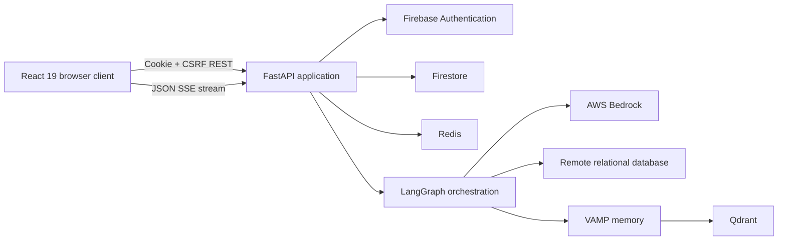

# Moonlit

> A streaming AI workspace for exploring and querying relational databases with natural language.

Moonlit combines a React application with a FastAPI and LangGraph backend. Authenticated users can
connect supported databases, ask questions, follow model and tool activity as it streams, inspect
query results and generated artifacts, and return to persisted conversations.

The repository is under active lifecycle and durability remediation. Implemented behavior and work
still in progress are separated in the
[project requirements document](project_requirements_document.md).

## Current capabilities

### Agent and conversations

- LangGraph orchestration backed by authorized AWS Bedrock models.
- Streaming responses over server-sent events, including reasoning, tools, usage, interruption,
  error, and completion events.
- Firestore-backed conversations, messages, execution results, user settings, and durable task
  metadata.
- Redis-backed production sessions, quotas, rate limits, and LangGraph checkpoints.
- Qdrant-backed VAMP summary memory for long-context retrieval.
- Conversation listing, loading, searching, renaming, deletion, pause, and resume workflows.
- Runtime-loaded skills for database querying, query history, diagrams, and web research.

### Database workflows

- PostgreSQL, MySQL, SQL Server, and Oracle adapters.
- Connection, disconnection, database switching, PostgreSQL schema selection, table discovery, and
  schema inspection.
- Server-side connection-target and SSRF policy.
- Dialect-aware safety checks for AI-generated read-only SQL.
- Bounded query execution, result persistence, and JSON-safe serialization.

### Frontend workspace

- Public landing and Firebase-backed authentication flows.
- Protected chat routes and a separately guarded administrator route.
- CodeMirror SQL workspace with query tabs and schema context.
- Material React Table inline results and FINOS Perspective analysis artifacts.
- React Flow and Dagre diagram artifacts.
- Markdown/GFM and Shiki-backed code rendering.
- Canonical dark-only interface with a 768px primary responsive transition.

## Architecture



The browser treats the backend as authoritative for authentication, authorization, model selection,
database access, quotas, and execution policy. Frontend route guards and validation improve the user
experience but do not replace backend enforcement.

## Technology stack

| Area | Current implementation |
|---|---|
| Backend runtime | Python 3.12+, FastAPI, Uvicorn |
| Agent orchestration | LangGraph, LangChain Core, LangChain AWS |
| LLM provider | AWS Bedrock |
| Durable application data | Firebase Authentication and Firestore |
| Shared runtime state | Redis |
| Long-context memory | Qdrant-backed VAMP |
| Database drivers | psycopg2, mysql-connector-python, pymssql, oracledb |
| Frontend | React 19, React Router 7, Vite 7 |
| UI and client state | Material UI 7, Emotion, TanStack Query 5 |
| Editors and rendering | CodeMirror 6, React Markdown, Shiki |
| Data and diagrams | FINOS Perspective, Material React Table, React Flow, Dagre |

## Repository layout

```text
Moonlit-AI-Agent/
├── back-end/
│   ├── api_contract/                 # Public schemas, protocols, and streaming contracts
│   ├── controller/                   # FastAPI HTTP routes
│   ├── core/                         # Security, logging, audit, and HTTP boundaries
│   ├── langgraph_orchestration/      # Agent graph, tools, checkpoints, leases, and streaming
│   ├── llm_provider/                 # Bedrock models, capabilities, token budgets, rate limits
│   ├── service/                      # Conversation, database, context, quota, and settings services
│   ├── skills/                       # Runtime agent skill definitions
│   ├── vamp_memory/                  # Firestore summaries and Qdrant vector retrieval
│   ├── tests/                        # Backend tests
│   ├── docs/                         # Backend architecture, design, memory, rules, and phases
│   └── README.md                     # Backend setup and configuration reference
├── front-end/
│   ├── src/
│   │   ├── api/                      # Centralized REST/SSE client contracts
│   │   ├── components/               # Shared UI primitives
│   │   ├── contexts/                 # Auth, database, settings, and theme state
│   │   ├── features/                 # Chat shell, sidebars, and artifacts
│   │   ├── hooks/                    # Feature coordination and streaming hooks
│   │   ├── pages/                    # Landing, authentication, chat, and admin routes
│   │   └── theme/                    # Canonical dark design system
│   └── docs/                         # Frontend architecture, design, memory, rules, and phases
└── project_requirements_document.md  # Current product scope and implementation status
```

## Local development

### Prerequisites

- Python 3.12 or newer.
- uv 0.12.5.
- Node.js 20.19+ or 22.12+ as required by the installed Vite version.
- Firebase Authentication, Firestore, and a Firebase Admin service account.
- AWS credentials and access to at least one configured Bedrock model.
- Qdrant when `VAMP_MEMORY_ENABLED=True`, which is the default.
- Redis for staging and production. Development can use documented in-memory fallbacks.
- A supported relational database if you want to exercise database workflows.

### Start the backend

```bash
cd back-end
uv sync --locked
```

Create `back-end/.env` and configure the required values described in
[the backend README](back-end/README.md#required-environment-variables-before-first-run). The
repository does not currently provide an `.env.example`, so do not copy credentials from a
committed template.

```bash
APP_ENV=development uv run --locked python main.py
```

The development API listens on `http://localhost:5000` by default. Swagger UI is available at
`http://localhost:5000/docs` only when debug mode is enabled.

### Start the frontend

```bash
cd front-end
npm ci
npm run dev
```

The Vite development server listens on `http://localhost:5173` by default and proxies the current
authentication and `/api` routes to the local backend.

## Configuration

Backend configuration is environment-driven through `back-end/config.py`. The complete variable
reference and environment-specific defaults live in
[back-end/README.md](back-end/README.md#environment-variables).

Important boundaries:

- `APP_ENV` selects development, staging, production, or testing behavior.
- `SECRET_KEY` is always required and must be at least 32 characters in production.
- `LLM_PROVIDER` currently supports `bedrock`.
- Firebase Admin credentials are required during application startup.
- `FIREBASE_WEB_PROJECT_ID` must match `FIREBASE_PROJECT_ID`.
- `REDIS_URL` and a non-memory `RATELIMIT_STORAGE_URL` are required in staging and production.
- Production CORS origins must be explicit and cannot contain a wildcard.
- Qdrant settings are required when VAMP memory is enabled.

Never commit `.env` files, credentials, database connection details, or provider secrets.

## API

Authentication routes are mounted at the root. All feature routes are mounted under `/api/v1`.
The backend currently exposes 37 endpoints across authentication, conversations, database
operations, context/settings, administration, and quota.

See the [backend endpoint reference](back-end/README.md#http-endpoints) for the complete inventory
and the [backend architecture](back-end/docs/architecture.md#http-boundary) for request-boundary
behavior.

## Security boundaries

- Firebase session cookies are verified server-side, including revocation checks on protected
  endpoints.
- Authorization is enforced independently for conversation ownership and administrator access.
- Mutating requests use CSRF protection except for explicitly configured bootstrap exemptions.
- Production CORS, Redis, cookie, and secret settings fail closed when required configuration is
  missing.
- Database targets and identifiers are validated server-side.
- AI-issued SQL is constrained to allowed read-only behavior and configured resource bounds.
- Public errors and logs are sanitized to avoid leaking credentials or infrastructure details.

Application checks do not replace least-privilege database roles, private-network controls,
provider IAM, secret management, backups, or production monitoring.

## Validation commands

Backend commands, from `back-end/` with the development tools installed:

```bash
pytest
ruff check .
ruff format --check .
mypy .
```

Frontend commands, from `front-end/`:

```bash
node --test $(find src -name '*.test.js' -print)
npm run lint
npm run biome
npm run knip
npm run build
```

## Deployment status

Deployment infrastructure is not fully represented or verified by this repository:

- No backend platform manifest is checked in.
- `front-end/vercel.json` still targets legacy route names and must be reconciled with the current
  authentication and `/api/v1` contracts before relying on it for deployment.
- Provider-specific free-tier, cold-start, capacity, and availability behavior is not an
  application guarantee.

Validate Firebase, Redis, Bedrock, Qdrant, database connectivity, proxy streaming, and security
settings in a production-shaped staging environment before deployment.

## Current limitations and active work

- AWS Bedrock is the only currently supported LLM provider.
- SQLite is not part of the connectable adapter set.
- The product intentionally exposes read-oriented AI database workflows rather than schema or data
  mutation.
- Several live database, streaming, interruption, error, and authorized-administrator frontend
  states do not yet have repeatable end-to-end fixtures.
- Backend command idempotency, protected-action durability, hard budgets, recoverable finalization,
  and truthful terminal outcomes remain active lifecycle work.

Read [project_requirements_document.md](project_requirements_document.md) and the
[backend phase tracker](back-end/docs/phases.md) before treating planned durability guarantees as
implemented.

## Documentation

### Project

- [Project requirements](project_requirements_document.md)
- [Backend setup and operations](back-end/README.md)

### Backend

- [Architecture](back-end/docs/architecture.md)
- [Design](back-end/docs/design.md)
- [Memory and evidence](back-end/docs/memory.md)
- [Engineering rules](back-end/docs/rules.md)
- [Remediation phases](back-end/docs/phases.md)

### Frontend

- [Architecture](front-end/docs/architecture.md)
- [Design system](front-end/docs/design.md)
- [Memory and evidence](front-end/docs/memory.md)
- [Engineering rules](front-end/docs/rules.md)
- [Audit phases](front-end/docs/phases.md)

## Contributing

Keep changes focused, follow the conventions in the relevant codebase, and update its documentation
when behavior or contracts change. Run the most relevant validation commands before opening a pull
request, and report any checks that could not be completed.
