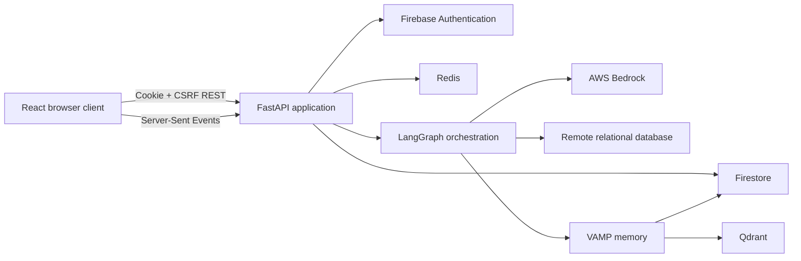
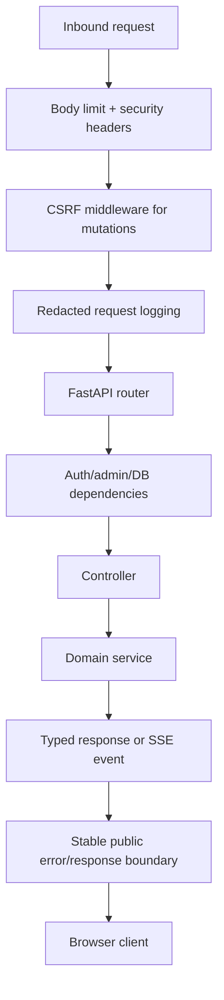
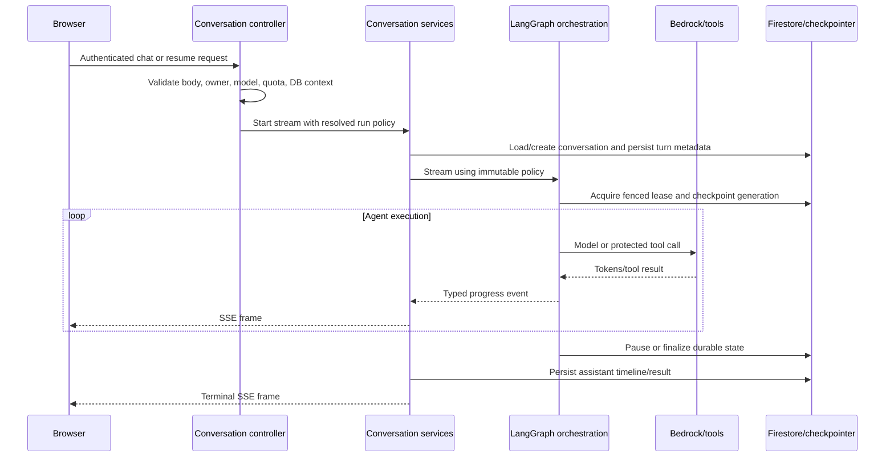

# Moonlit Back-End Architecture

## Scope and Authority

This document describes the deployed back-end shape represented by the repository. It is a map of
current code, not permission to redesign it. When this document conflicts with executable code,
tests, or public API schemas, those sources take precedence and this document must be corrected.

Related references:

- `back-end/README.md` — setup, endpoints, configuration, dependencies, and operational commands.
- `back-end/docs/design.md` — design intent and architectural decisions.
- `back-end/docs/rules.md` — mandatory engineering constraints.
- `back-end/docs/phases.md` — audit and remediation sequence.
- `back-end/docs/memory.md` — evidence, decisions, findings, and current working context.
- `project_requirements_document.md` — repository-level product requirements.

## System Context

Moonlit's back end is a Python 3.12+ FastAPI service. It authenticates users with Firebase session
cookies, stores durable application records in Firestore, uses Redis for shared runtime state,
orchestrates AI work with LangGraph and AWS Bedrock, connects to user-selected relational
databases, and uses Qdrant-backed VAMP memory for long-context retrieval.

## Module Boundaries

| Area | Responsibility | Must not own |
|---|---|---|
| `main.py` | Application construction, lifespan, middleware, error handlers, router mounting | Domain business logic |
| `config.py` | Environment-derived settings and environment validation | Request-specific state |
| `composition.py` | Registration of concrete runtime-port implementations | Feature behavior |
| `api_contract/` | Pydantic wire schemas, protocols, run-policy types, streaming event contracts | Concrete infrastructure |
| `controller/` | HTTP validation, authentication dependencies, response construction, route orchestration | Large domain workflows or direct driver logic |
| `service/` | Conversation, database, context, quota, settings, and persistence behavior | HTTP presentation concerns |
| `langgraph_orchestration/` | Agent graph, prompts, tools, checkpoints, leases, budgets, and event translation | Browser state or HTTP route ownership |
| `llm_provider/` | Bedrock client/model creation, capabilities, token budgets, provider rate limits | Conversation persistence |
| `vamp_memory/` | Summary blocks, embedding, vector search, retrieval budgeting, and maintenance | Primary conversation ownership |
| `core/` | Cross-cutting error, audit, logging, HTTP-boundary, authorization, and security utilities | Feature-specific policy |
| `skills/` | Validated agent skill definitions and registry | Runtime secrets or executable application code |
| `tests/` | Unit, contract, regression, and infrastructure-boundary coverage | Production behavior |

Dependencies should point inward toward contracts. Cross-feature concrete wiring belongs in
`composition.py`; consumers obtain registered implementations through typed accessors in
`api_contract/runtime_ports.py`.

## Application Lifecycle

`main.py` creates the application and registers runtime ports at import time. The FastAPI lifespan
then performs environment-dependent initialization:

1. Validate production settings and Firebase project consistency.
2. Initialize Firebase Admin and Firestore.
3. Connect Redis when configured; production-like environments fail closed without shared Redis.
4. Initialize the LangGraph checkpointer: shared Redis in staging/production and in-memory state in
   development.
5. Create per-user quota state and bind the LLM rate limiter to Redis when available.
6. Initialize token budgets and prewarm configured Bedrock chat models.
7. Validate VAMP/Qdrant readiness and start the maintenance task when VAMP is enabled.

Shutdown cancels and drains VAMP work, closes VAMP/Qdrant clients, shuts down checkpointing, and
closes Redis. New long-lived resources must be initialized and closed through the same lifespan
boundary.

## HTTP Boundary

Authentication routes are mounted without a version prefix. The combined feature router is mounted
under `/api/v1`.

The boundary provides request-body limits, CORS, response-security headers, HTTP rate limiting,
request validation, request-ID-aware logging, and stable public error envelopes. Controllers must
use Pydantic schemas from `api_contract/` where a public request or response contract exists.

## Authentication, Authorization, and Session State

- Firebase ID tokens are exchanged for secure Firebase session cookies.
- Protected endpoints verify the session cookie with revocation checks through
  `get_current_user`.
- Authorization is enforced separately: conversation ownership, administrator access, and
  authenticated database context are server-side decisions.
- Mutating requests use a double-submit CSRF cookie/header check except for explicitly configured
  bootstrap exemptions.
- Per-session application state is keyed by a SHA-256 digest of the session cookie. Redis is the
  shared store; an in-process fallback is development-only.
- Database connection metadata is cached state, never an authentication source. Authentication
  must occur before protected state is read.

## Conversation and Agent Flow

One `ResolvedRunPolicy` is selected at the outer conversation boundary and carries the effective
task mode, model/provider, database-connected state, and run budgets. It must be threaded unchanged
through services and orchestration. `RunControl` provides in-process cancellation, deadline, and
tool-reservation state; durable run ownership additionally uses a run ID plus monotonic fence.

Checkpoint state is isolated by immutable physical generations. A logical conversation thread is
mapped to a generation containing the run identity and fence. Resume work clones and verifies the
approved source generation before activation; an incomplete clone must never become active.

The active remediation record in `memory.md` and `phases.md` remains authoritative for lifecycle
guarantees that are implemented, under review, or still planned. Do not describe a planned terminal
durability or idempotency contract as complete until its exit evidence is recorded there.

### Agent tool result boundary

The 19 tools in `langgraph_orchestration.tools.ALL_TOOLS` must have exact matching entries in the
argument- and result-contract registries. Arguments reject undeclared fields. Successful raw results
must contain their tool's core fields and pass the Pydantic result model; an unknown, missing, or
malformed result becomes `TOOL_RESULT_INVALID` and raw data is not echoed as successful evidence.

`ToolExecutor.summarize()` derives UI and model values independently when their disclosure rules
differ. In particular, retrieved VAMP text is validated and supplied to the model as untrusted
reference data, while the SSE/persisted timeline receives only the lookup query and found/not-found
status. Skill bodies similarly remain in model context; the timeline receives only skill metadata.
The bespoke skill, web-search, query-history, and UI-action emitters call the canonical result
structurer before `tool_end`.

The frontend maintains an exact registered-agent-tool presentation catalog separately from
frontend-only lifecycle actions. Every registered tool has a deterministic summary and detail kind.
Known database/search/history relationships have deliberate presentations, while a bounded generic
view handles unknown historical structured payloads without using raw HTML. Query rows remain in the
existing interactive result table rather than being duplicated in timeline details. As a privacy
backstop, the presentation boundary removes the legacy `retrieve_memory.memories` field before a
previously persisted timeline result can reach the generic renderer.

Exact row-count batches use a 20-second database-side budget per requested table. The outer agent
tool timeout uses the same batch-sized budget plus five seconds for driver error propagation and
connection cleanup, so a combined statement is not constrained by the former singular-tool limit.
The database timeout is installed before the count statement; failure to install a supported
statement/driver timeout fails the operation rather than running it without a bound.

## Database Access Flow

The database feature supports PostgreSQL, MySQL, SQL Server, and Oracle through adapters under
`service/database/adapters/`.

1. A protected controller validates the public request.
2. The connection service validates connection input and applies host/SSRF restrictions.
3. The connection manager creates or reuses the correct adapter/pool.
4. Schema and query services invoke adapter operations.
5. SQL safety policy constrains AI-executed work to allowed read behavior; explicit user SQL follows
   its separately defined route policy.
6. Results are normalized into JSON-safe public schemas before crossing HTTP or SSE boundaries.

Driver calls that block must be moved off the event loop. User-supplied identifiers, connection
values, and database error messages remain untrusted at every layer.

## Data Ownership

| Store | Canonical data |
|---|---|
| Firebase Authentication | User identity and session-cookie verification |
| Firestore | Conversations, messages, execution results, user settings/context, summaries, and durable task metadata |
| Redis | Shared session state, quota/rate-limit counters, and production LangGraph checkpoints |
| Qdrant | Derived VAMP vector embeddings and retrieval indexes |
| Remote databases | User-owned relational data; Moonlit accesses it through configured adapters |

Qdrant data is derived and must not become the sole owner of conversation history. Cached Redis
database context is scoped to an authenticated session. Firestore ownership checks must use the
authenticated user ID and canonical conversation ID rather than values reconstructed from a
composite string.

## Errors, Logging, and Audit

- Public failures use stable error codes/messages; raw driver, provider, and infrastructure text
  must not cross the trust boundary.
- `core/errors.py` classifies and sanitizes failures.
- `core/logging.py` propagates request IDs.
- `core/security.py` redacts secrets and validates security-sensitive strings.
- `core/audit.py` emits structured audit records with redaction.
- Sensitive headers and configured request bodies are never logged verbatim.

Meaningful failures must be logged with safe operational context. Broad exception handling is only
acceptable at a deliberate boundary where the failure is classified, cleanup is guaranteed, and
the caller receives a truthful outcome.

## Deployment Topology

Development may use in-memory session/checkpoint/rate-limit fallbacks. Staging and production are
multi-worker environments and require shared Redis for application state, checkpointing, quota,
and rate limiting. API documentation routes are enabled only in debug environments. Bedrock,
Firebase, Redis, Qdrant, and remote database behavior must be validated in production-shaped
staging before deployment because unit tests intentionally replace those services.

## Known Structural Pressure Points

- Conversation streaming and LangGraph orchestration remain large, high-risk coordination paths.
- Durable terminal ordering, command idempotency, protected-action fencing, and bounded recovery
  are tracked in the active remediation phases; status must be read from `phases.md`.
- Firestore document growth, result-size bounds, event-loop blocking, and VAMP retry/budget behavior
  remain explicitly tracked findings in `memory.md`.
- Static type configuration exists, but type-checking coverage and third-party typing limitations
  must be reported accurately rather than assumed green.

These pressure points justify focused extractions only when an approved phase requires them. They
do not authorize broad rewrites.
