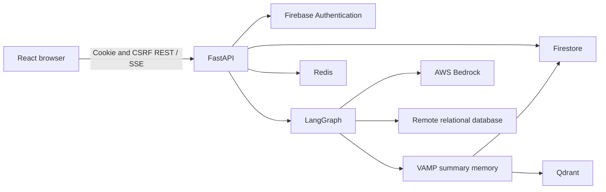

# Application architecture

Moonlit has a React single-page application and a Python FastAPI service in one repository. This guide describes current source boundaries and their rationale. Feature contracts live in the linked guides; outstanding guarantees live in [product scope](product.md#engineering-backlog).

## System and data ownership




| Store                   | Responsibility                                                                                       |
| ------------------------- | ------------------------------------------------------------------------------------------------------ |
| Firebase Authentication | Identity, ID tokens, and session-cookie verification                                                 |
| Firestore               | Conversations/messages, execution results, settings/context, usage, summaries, and task metadata     |
| Redis                   | Shared sessions, quotas, provider/HTTP limits, production checkpoints, and account-activity barriers |
| Qdrant                  | Derived VAMP summary embeddings and retrieval indexes                                                |
| Connected database      | User-owned relational data; deleting a Moonlit account does not erase it                             |

Firestore remains the canonical conversation store. Qdrant retrieval supplements conversation context; it does not replace durable history. Account-erasure Redis barrier keys intentionally have no TTL, unlike expiring session/quota keys.

## Frontend

[main.jsx](../front-end/src/main.jsx) composes the router, React Query, theme/settings, error handling, authentication, settings synchronization, and database context. [App.jsx](../front-end/src/App.jsx) owns lazy route composition.


| Route                    | Surface                                        | Access        |
| -------------------------- | ------------------------------------------------ | --------------- |
| `/`                      | Landing page                                   | Public        |
| `/auth`                  | Authentication                                 | Public        |
| `/chat/:conversationId?` | New or saved conversation                      | Authenticated |
| `/dashboard/:section?`   | Personal overview, usage, and account surfaces | Authenticated |
| `/admin`                 | Operational context metrics                    | Administrator |

[ChatWorkspacePage](../front-end/src/pages/ChatWorkspacePage.jsx) wires `useChatPageController`, supplies slots to `AppShell`, and mounts `GlobalOverlays`. Feature hooks own state coordination. `ChatColumn` composes content; `ChatLayout` owns the stable welcome/transcript/composer layout and transcript scroll container. `ArtifactLoader` hosts SQL, table/analysis, and diagram views.

State belongs at the smallest useful boundary:

- Context owns authentication, database state, settings, and theme.
- React Query owns shared request caching; `src/api/` owns endpoint paths and HTTP/SSE handling.
- Route/session identity scopes conversation history, drafts, SQL tabs, and selected artifacts.
- Local components own input, popovers, and presentation state.

The application root prevents document scrolling. Individual panels own scrolling; desktop uses a sidebar and resizable artifact panel, while narrow screens use drawers and fullscreen overlays. The primary layout transition is 768px. See the [design system](design-system.md).

Heavy routes and artifact libraries are lazy-loaded or isolated into build chunks. The Perspective chunk remains a bundle-size concern. A second global store or styling framework is not needed by the current boundaries.

## Backend


| Module                                                           | Responsibility                                                                      |
| ------------------------------------------------------------------ | ------------------------------------------------------------------------------------- |
| [main.py](../back-end/main.py)                                   | App construction, middleware, lifespan, errors, router mounting                     |
| [config.py](../back-end/config.py)                               | Environment settings and validation                                                 |
| [composition.py](../back-end/composition.py)                     | Concrete implementations of cross-feature runtime ports                             |
| [api_contract/](../back-end/api_contract/)                       | Public schemas, run policy, streaming contracts, and protocols                      |
| [controller/](../back-end/controller/)                           | HTTP validation, dependencies, authorization, and transport orchestration           |
| [service/](../back-end/service/)                                 | Conversation, database, context, dashboard/account, quota, and persistence behavior |
| [langgraph_orchestration/](../back-end/langgraph_orchestration/) | Graph, tools, prompts, leases, checkpoints, and streaming                           |
| [llm_provider/](../back-end/llm_provider/)                       | Bedrock clients, model authorization/capabilities, token counting, and limits       |
| [vamp_memory/](../back-end/vamp_memory/)                         | Summary blocks, embedding, retrieval budgeting, and maintenance                     |
| [core/](../back-end/core/)                                       | HTTP boundaries, errors, logging/audit, security, and account activity              |
| [skills/](../back-end/skills/)                                   | Validated runtime skill prompts and registry                                        |

Cross-feature consumers use typed runtime ports from `api_contract/runtime_ports.py`, wired through `composition.py`. Feature-local helpers can remain concrete. This keeps infrastructure substitutable for boundary tests without adding a generic repository abstraction everywhere.

## Startup and shutdown

Configuration is read at import time. The lifespan validates production settings and Firebase project consistency, initializes Firestore and Redis, selects the checkpointer, binds quota/provider limits, initializes token budgets, prewarms Bedrock clients, and starts VAMP maintenance when enabled.

Development/testing use in-memory checkpoints. Staging/production use shared Redis checkpoints and require `REDIS_URL`; HTTP limiting also requires shared storage when enabled. Startup diagnostics distinguish connectivity probes from client construction: prewarming a Bedrock client is not proof of successful inference. Qdrant startup failures are logged and can be retried; successful API startup alone does not prove memory readiness.

Shutdown drains owned memory work and closes memory, checkpoint, and Redis resources. Account admissions must outlive response finalization and detached work that can still write account data. See [account erasure](features/account-erasure.md).

## HTTP and trust boundaries

Authentication endpoints are unversioned. [api_router.py](../back-end/api_router.py) mounts feature routers under `/api/v1`, including dashboard and account routes. Debug OpenAPI is the endpoint/schema reference; streaming semantics require the [conversation guide](features/conversations.md).

The outer response boundary applies safe request IDs, response-security headers, and standardized error envelopes, including rejected requests. Request-body limits apply before parsing. Mutating cookie-authenticated requests use CSRF checks with explicitly configured exemptions. Privileged-action audit middleware records selected outcomes without reading sensitive request bodies.

Firebase authentication proves identity; resource ownership, administrator access, model selection, and database-session authorization are separate checks. Client guards improve navigation but cannot authorize backend work. Database metadata, SQL, stored messages, tool results, and provider output remain untrusted.

Public failure boundaries use stable codes and sanitized messages. Dedicated audit events exclude raw credentials and SQL, and database diagnostics use safe helpers. Other application and third-party logging paths need separate review; these controls are not a guarantee that every log is sanitized. The local audit sink requires deployment-managed collection and retention. See [security findings](security/findings.md) and [operations](operations.md#audit-logging).

### HTTP response contract

Every HTTP response is finalized by a pure-ASGI outer boundary. It replaces
the configured security headers and `Server`, removes `X-Powered-By`, and
returns a safe `X-Request-ID`. A valid inbound ID matching
`[A-Za-z0-9_-]{1,64}` is echoed; missing, duplicate, or unsafe values are
replaced with a generated opaque ID. The same ID is bound to application logs
for the duration of the request and cleared afterward.

CSRF, request-size, validation, authentication, rate-limit, framework HTTP,
and unhandled failures use the common JSON error envelope:

```json
{
  "status": "error",
  "error": "STABLE_MACHINE_CODE",
  "message": "Safe human-readable message.",
  "details": {}
}
```

Unhandled exceptions return `500 INTERNAL_SERVER_ERROR` without exposing the
exception message. The response boundary forwards ASGI response frames as they
arrive and does not buffer streaming responses.

## Agent lifecycle decisions

One immutable `ResolvedRunPolicy` carries effective mode, model/provider, database context, and budgets through a run. Fenced ownership uses `(run_id, fence)`; immutable physical checkpoint generations prevent an incomplete copy from becoming the active resume source.

Progress frames are transient observations. The target is to publish a successful terminal only after required durable state is readable, with distinct interrupted, partial, empty, and failed-finalization outcomes. Full command idempotency, durable protected-action reservation, and recoverable finalization remain backlog items; their presence in old design specifications was not evidence of completion.

Cancellation is cooperative. A cancelled Python await does not prove that a blocking driver or external write stopped. Source-specific query deadlines, cancellation support, and result provenance are described in [database querying](features/database-querying.md).
