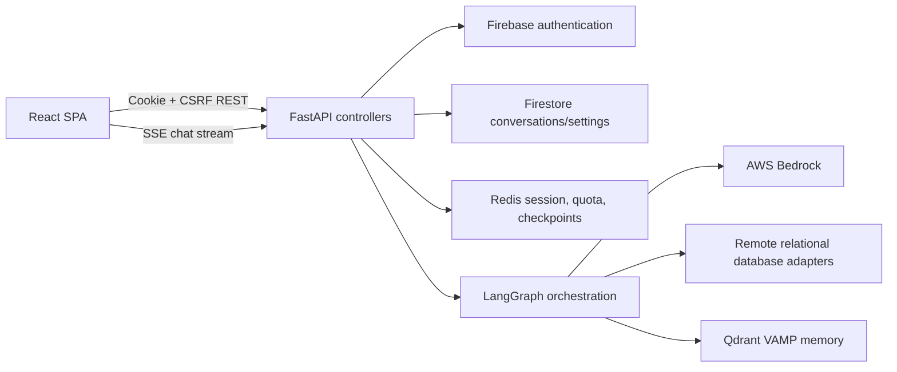
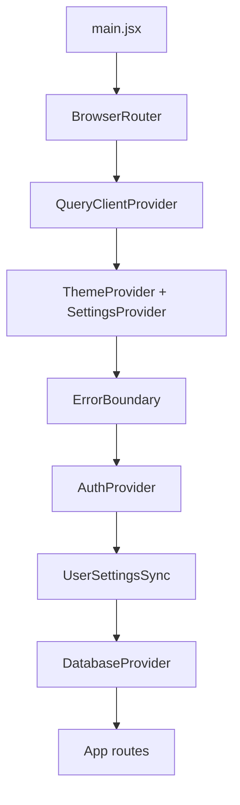
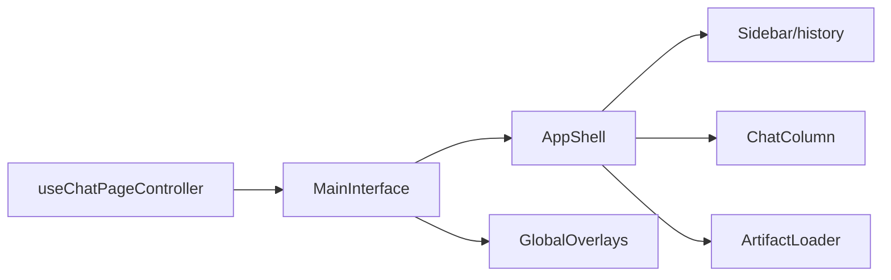
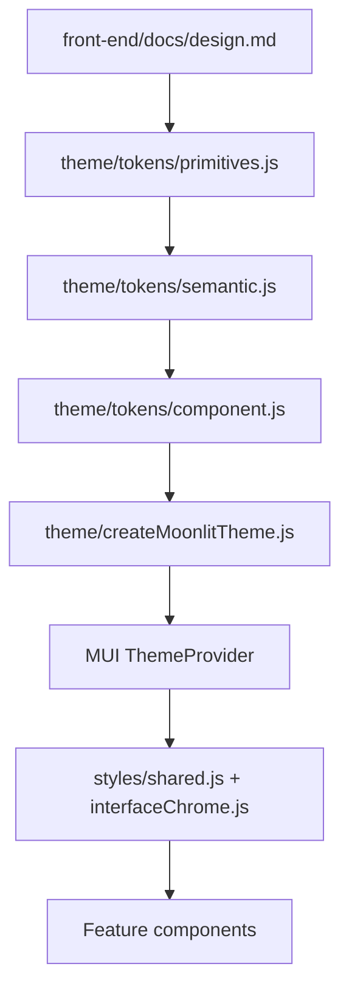

# Moonlit Front-End Architecture

Canonical location: `front-end/docs/architecture.md`

## Current Architecture

### High-Level Application Flow

### Frontend Entry and Providers

- `front-end/src/main.jsx` mounts React and composes routing, React Query, theme/settings,
  error handling, authentication, user-setting sync, and database state.
- `front-end/src/App.jsx` defines lazy routes for landing, authentication, chat, and admin.
- `front-end/src/guards/ProtectedRoute.jsx` and `AdminRoute.jsx` enforce route boundaries.

### Routing

| Route | Surface | Guard |
|---|---|---|
| `/` | Landing | Public |
| `/auth` | Sign in/sign up | Public |
| `/chat` | New chat | Authenticated |
| `/chat/:conversationId` | Existing conversation | Authenticated |
| `/admin` | Administration | Administrator |

### Authenticated Application Shell

`MainInterface.jsx` is a composition root. `useChatPageController` coordinates feature hooks and
passes slots into `AppShell`.

- Desktop: animated sidebar, flexible chat column, resizable artifact column.
- Narrow layout: sidebar drawer, full-width chat, full-screen artifact overlay.
- Panel surfaces and seams are centralized in `features/styles/interfaceChrome.js`.

### Chat Component Architecture

- `ChatColumn.jsx`: owns the chat layout slots and scroll/composer positioning.
- `WelcomeScreen.jsx`: empty state, suggestions, and composer.
- `MessageList.jsx`: bounded transcript, user/assistant turns, loading/error states, artifacts.
- `ChatInput.jsx`: message input, context selection, SQL action, model selection, send/stop.
- `MarkdownRenderer.jsx`: Markdown/GFM presentation and code-block routing.
- `CodeViewer.jsx`: Shiki-backed static and streaming code presentation.
- `ai-response-steps/*`: reasoning/tool timeline and result details.
- `InlineExecutionTable.jsx`: fetched execution results rendered with Material React Table.
- `GuidedConfirmationPrompt.jsx`: pause/continue interaction above the composer.

### State Management

- React context: authentication, database state, user settings/theme.
- React Query: shared request cache configuration.
- Route state: selected conversation identifier.
- Feature hooks: conversations, streaming, scrolling, sidebar, overlays, artifacts, and query
  execution.
- Component-local state: input text, anchors, copy feedback, menus, and presentation toggles.

No global client store is used. This is appropriate for the current boundaries and should not be
replaced during focused UI compliance work.

### API Integration

- `src/api/client.js` centralizes cookie credentials, CSRF headers, JSON parsing, and safe API
  errors.
- `src/api/endpoints.js` centralizes endpoint paths.
- Feature API modules expose domain operations.
- Streaming endpoints deliberately request identity encoding to prevent proxy buffering.

### Design and Theme Architecture

The runtime now resolves every route to the canonical dark theme. Legacy light-theme preferences
are ignored, the selectable light-mode path has been removed, and the primary MUI `md` breakpoint
matches the canonical 768px topology transition.

### Tech Stack

- React 19, React Router 7, TanStack Query 5.
- Material UI 7 and Emotion.
- Framer Motion for shell transitions.
- React Markdown, remark-gfm, and Shiki for response rendering.
- CodeMirror for SQL editing.
- React Flow/Dagre and Perspective for artifacts.
- Firebase Web SDK for authentication.

## Important Architectural Decisions

- The application root prevents document scrolling; individual panels own scrolling.
- `MainInterface` is orchestration-only while feature hooks own behavior.
- Theme primitives, semantic roles, and component overrides are centralized.
- Heavy artifact features are lazy-loaded or isolated into build chunks.
- Conversation rendering caps initially visible messages for long transcripts.
- The authenticated shell changes topology at the configured desktop breakpoint.

## Known Architectural Problems

- The canonical design uses a 4px spacing scale while the MUI theme retains an 8px spacing
  function, so some components still use fractional multipliers.
- Several large chat and sidebar files combine many presentation concerns, increasing review risk.
  They should only be split when active work exposes a clear, testable boundary.
- Focused design audits and browser matrices exist, but screenshot-based visual regression is not
  automated and several authenticated database/streaming states lack repeatable fixtures.
- The Perspective artifact vendor chunk remains oversized in production builds.
- Root `README.md` describes older libraries and capabilities in places; actual code is the source
  of truth for implementation details.

## Recommended Improvements

These are scoped recommendations, not current architecture:

1. Preserve the canonical dark-only theme and 768px topology contract with focused tests.
2. Replace repeated one-off geometry with existing semantic roles only when touching the owning
   feature.
3. Add deterministic fixtures for database, streaming, pause, error, and administrator states.
4. Add screenshot-based visual regression after those fixtures are stable.
5. Split large presentation modules only when an isolated responsibility can be tested directly.
6. Reduce the Perspective bundle cost without changing its public artifact boundary.
7. Reintroduce light mode only after a future approved `front-end/docs/design.md` extension defines
   it.
